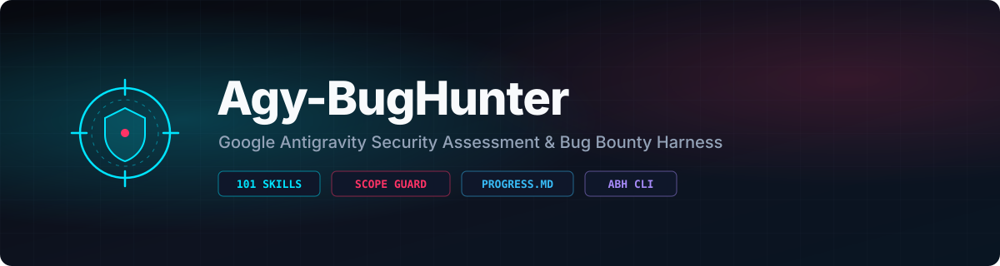

# Agy-BugHunter

Native **Google Antigravity** harness for authorized security assessments, bug bounty hunting, and external red-team engagements.

Includes:
- **101 native skills** (85 methodology, recon, web/API/cloud/web3/enterprise auditing skills + 16 `cmd-*` workflows).
- **Workspace rules** (`AGENTS.md` + `.agent/rules/`) tailored for Antigravity and Windows/Python.
- **Automatic scope protection** (`scope-guard`): native `PreToolUse` hook in `.agent/hooks.json` backed by the deterministic `engine/scope.py` engine (*deny-wins* and *default-deny*).
- **Persistent audit progress tracking** (`PROGRESS.md` + `progress.json`) to pause and resume engagements without losing context.
- **Unified `abh` CLI** to install the global plugin, scaffold standalone engagement folders, validate scope, and update progress with short commands.
- **Optional HackerOne MCP server** (`mcp/hackerone/server.py`).

---

## 1. Quick Installation (One-Time Setup)

From the root of `Agy-BugHunter`:

```powershell
# 1. Install the global `abh` (and `cbh`) CLI commands
pip install .

# 2. Install the global plugin in Google Antigravity
abh install

# (Optional) Install including the HackerOne MCP server:
abh install --mcp
```

This installs the self-contained plugin into `~/.gemini/config/plugins/agy-bughunter/`.

- **Enable / disable the plugin:** from Antigravity **Settings → Plugins** or via CLI (`agy plugin disable agy-bughunter` / `agy plugin enable agy-bughunter`), so you only keep it active while auditing.
- **Uninstall:** `abh uninstall`

---

## 2. Start a New Engagement (In Any Folder)

You don't need to duplicate this repository or mix client data here. Create an isolated folder anywhere on disk:

```powershell
abh new C:\Audits\acme --name "Acme Corp"
```

This scaffolds a clean workspace ready for your assessment:

```text
C:\Audits\acme\
├── scope.md        # Authorized assets (In scope / Out of scope)
├── PROGRESS.md     # Human-readable dashboard (phases, findings, notes)
├── progress.json   # Structured state for seamless session resume
├── recon/          # Reconnaissance outputs
├── findings/       # Validated findings and reports
└── evidence/       # Redacted PoCs, screenshots, and HARs
```

---

## 3. Configure and Validate Scope (`scope.md`)

Edit `scope.md` inside your engagement folder:

```markdown
## In scope
- *.acme.com
- 203.0.113.0/24

## Out of scope
- admin.acme.com
- billing.acme.com
```

*(Optional)* Import scope from a public program directly with `abh`:

```powershell
abh import h1:<handle> -o C:\Audits\acme\scope.md
```

**Manual validation from your engagement folder:**

```powershell
abh scope api.acme.com admin.acme.com
```

**Automatic protection (`scope-guard`):** while the plugin is active, the `PreToolUse` hook inspects network/recon commands (`curl`, `httpx`, `nuclei`, `ffuf`, `subfinder`, `nmap`, `sqlmap`, `Invoke-WebRequest`, etc.) and **automatically blocks** any target not authorized in the active folder's `scope.md`.

---

## 4. Save and Resume Audit Progress

Each engagement tracks its state in `PROGRESS.md` and `progress.json`:

- **Automatic resume:** when you open the engagement folder in Antigravity in a new session, the agent reads `PROGRESS.md` at startup (enforced by `AGENTS.md`) and continues without repeating dismissed checks.
- **Update progress:** the agent updates it during the assessment, and you can also manage it from the terminal:

```powershell
# View current status
abh status

# Update a phase (scope, recon, surface, hunting, validation, reporting)
abh phase recon done "42 live hosts, GraphQL exposed"

# Log a tested target/class (including negative results)
abh tested api.acme.com idor --result negative --note "UUIDv4 + ownership check"

# Record a finding
abh finding "IDOR on /api/v1/invoices" High api.acme.com --status validated

# Save a note or next step
abh note "Next session: check OAuth redirect_uri on auth.acme.com"
```

---

## 5. Workflow in Google Antigravity

Open your engagement folder (`C:\Audits\acme`) in **Google Antigravity** and describe what you need; the 101 skills load automatically by context:

| Phase | Example Prompt |
|---|---|
| Start / Resume | *"Read `PROGRESS.md` and `scope.md`, confirm scope, and tell me where we left off"* |
| Reconnaissance | *"Run recon on `acme.com`, rank the attack surface, and update `PROGRESS.md`"* |
| Targeted Testing | *"Audit the GraphQL endpoints on `api.acme.com` for IDOR and auth bypass"* |
| Chaining | *"I found an Open Redirect on `/oauth/callback`, check how to chain it to ATO"* |
| Validation (7-Question Gate) | *"Run the 7-Question Gate on this finding before drafting the report"* |
| Final Report | *"Write the report in `findings/` applying evidence hygiene and redacting cookies/PII"* |

---

## 6. HackerOne MCP Server (Optional)

If you installed with `abh install --mcp`, `mcp/hackerone/server.py` is configured in `~/.gemini/config/plugins/agy-bughunter/mcp_config.json`:

- **Without credentials:** enables disclosed report search (`search_disclosed_reports`) and public program scope lookup (`get_program_scope`).
- **With credentials:** set `HACKERONE_API_USERNAME` and `HACKERONE_API_TOKEN` in that file to query private programs and your own reports (read-only).

---

## 7. Repository Structure

| Path | Purpose |
|---|---|
| `AGENTS.md` | Always-on global rules for Antigravity |
| `.agent/rules/` | Modular rules (`01-entorno-sistema.md`, `02-alcance-autorizado.md`, `03-flujo-trabajo.md`) |
| `.agent/skills/` | 101 native skills (`SKILL.md` + `references/` and `scripts/`) |
| `.agent/hooks.json` | Native `PreToolUse` hook (`scope-guard`) |
| `.agent/scripts/` | `validate_scope.py`, `scope_guard_hook.py`, and `audit_progress.py` |
| `cbh/` | `abh` (`agy_cli.py`) and `cbh` (`cli.py`, `scope_import.py`) CLIs |
| `engine/` | Deterministic scope engine (`scope.py`), diff, and unit tests |
| `mcp/hackerone/` | HackerOne stdio MCP server (Python stdlib) |

---

## Credits & License

This project is based on **[Claude-BugHunter](https://github.com/elementalsouls/Claude-BugHunter)** created by **[Sachin Sharma](https://github.com/elementalsouls)**, adapted for **Google Antigravity** with custom workspace rules, native hooks, `abh` CLI, and persistent audit progress tracking.

- Code is licensed under the **[MIT License](LICENSE)** (`Copyright (c) 2026 Sachin Sharma`).
- Documentation and skill content are licensed under **[CC BY 4.0](LICENSE-CONTENT)**.
- See [NOTICE](NOTICE) for additional notices and third-party attributions.
